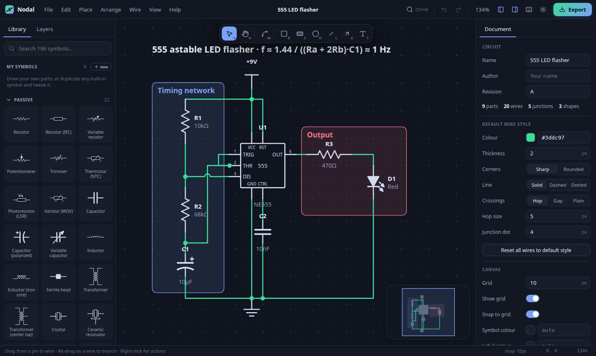

# Nodal — circuit & schematic designer

[](https://github.com/JPMarcelino/nodal/actions/workflows/ci.yml)
[](https://github.com/JPMarcelino/nodal/releases/latest)
[](LICENSE)

Nodal is a fast, good-looking schematic editor. It's one React + TypeScript codebase that runs as:

- a **desktop app for Windows and Linux** (Tauri: small native installers, built by GitHub Actions), and
- a **web app**: <https://jpmarcelino.github.io/nodal/>



**Download:** [latest release](https://github.com/JPMarcelino/nodal/releases/latest). On Windows use the `.msi` or `-setup.exe`; on Linux use the `.AppImage` (`chmod +x`, then run it), `.deb` or `.rpm`.

## Features

### Symbol library (~240 parts)
- **Passive:** resistors (US and IEC), variable resistors, potentiometers, trimmers, NTC/PTC thermistors, LDRs, varistors, resistor networks, 4-terminal current-sense resistors, capacitors (ceramic, polarized, bipolar, variable), inductors, coupled inductors, ferrite beads, transformers (center-tapped, dual secondary), crystals, resonators, fuses, polyfuses, spark gaps, gas discharge tubes, antennas
- **Semiconductors:** diodes, dual diodes, LEDs, Zener, Schottky, tunnel, TVS, varactor, photodiode, laser diode, DIAC, bridge rectifier, NPN/PNP (plain and circled), Darlington, phototransistor, N/P MOSFETs, depletion MOSFET, N/P JFETs, IGBT, SCR, TRIAC, UJT, optocouplers (transistor and TRIAC output), gate driver, vacuum tubes (triode, pentode)
- **ICs and analog:** op-amps (single and dual), comparator, TL431 shunt reference, voltage reference, LDO with enable, oscillator module, instrumentation amp, 555, linear and adjustable regulators, buck converter, generic 8/14/16-pin ICs, ATmega328P, generic MCU, EEPROM, ADC, DAC, H-bridge, USB-UART
- **Logic:** AND/NAND/OR/NOR/XOR/XNOR (2, 3 and 4 inputs), Schmitt NAND, NOT, buffers, Schmitt triggers, tri-state, D/JK/T flip-flops, SR latch, multiplexers, demux, 3→8 decoder, adders, counter, 74HC595, clock source, tie-high/low
- **Power and sources:** ground (signal, chassis, earth), supply rails, cells and batteries, DC/AC/pulse/current sources, dependent sources (including a 4-terminal VCCS), solar cell, generator, power flag
- **Switches and relays:** SPST, SPDT, DPST, DPDT, push buttons (NO/NC, 4-pin tactile), rotary encoder, reed, limit, rotary, DIP, relay coil, SPDT/DPDT/solid-state relays, breaker, contactor, thermal switch, e-stop
- **Output and sensors:** lamp, neon lamp, photo interrupter, RGB LED, 7-segment, buzzer, speaker, microphone, piezo, DC/AC/stepper motors, servo, solenoid, heater, fan, bell, headphones, thermocouple, Hall, temperature, PIR, ultrasonic, IMU, LCD 16×2, OLED
- **Meters and test:** volt/am/ohm/watt meters, galvanometer, oscilloscope, frequency counter, function generator, test point, probe
- **Connectors and labels:** net labels, global labels, in/out/bidirectional ports, off-page connector, no-connect flag, terminals, terminal blocks, pin headers (1×2 to 1×12, 2×3 to 2×10), D-sub 9, SMA, bus entry, DC jack, 3.5 mm audio jack, USB, USB-C, RJ45, BNC, plug and socket, banana jack, mounting hole, fiducial

You can search the library, mark favourites (★), and see recently used parts. Click a part to place it, or drag it onto the canvas.

### Symbol types (several drawings per part)
Many parts can be drawn more than one way. A symbol with types shows a small **types badge** on its tile; **hover** it for a clean popup preview, and **click** it to open a type picker (e.g. N- and P-channel MOSFETs ship with **Type A · standard**, **Type B · source arrow** and **Type C · simplified/gate-bubble**, and diodes, capacitors and inductors have alternates too). The same preview appears on hover in the command palette, and the type travels with the part.

### Making your own symbols
Open the symbol editor with **Ctrl+Shift+N**, the **+ New** button, or **Customise symbol** on any part:
- **Draw:** lines, polylines/polygons, rectangles, circles and text on a grid, plus pins that snap onto the symbol outline
- **Style:** line colour, fill colour, line width (presets or any value) and solid or dashed lines, for the selected shapes or for new ones. Leave a colour empty to follow the theme.
- **Nothing gets lost:** closing with unsaved changes (Esc, ×, or clicking outside) asks whether to save, and your unsaved work is kept, so it can be restored the next time the editor opens.
- **Chip / IC builder:** type the pin names for each side and the box, leads, labels and pin numbers are generated
- **Import SVG:** paste or load an SVG; it is converted and scaled to fit
- **Code:** a short text format, for precise edits
- **Drawing type:** set *“Drawing type”* to an existing symbol to save your drawing as a **new type** of it — it then appears in that part's type picker, and you can manage (edit/delete) the other types from the same panel. Everything in the editor snaps to the same 10 px grid.

Your symbols are kept in *My symbols*. Every circuit file also stores a copy of the symbols it uses, so files open correctly on other machines.

### Sharing & collaboration
**Live collaboration.** Click **Share** in the top bar, then **Start live session**. A link is copied for you; anyone who opens it watches the circuit live as you edit it:
- **The link is view-only.** Only you, in the browser that started the session, can change the circuit; the relay rejects edits from anyone else. Guests don't keep the circuit: when they leave, their own circuit comes back, and nothing from the session goes into their version history. Guests can choose **Leave and keep a copy** to keep the shared circuit as their own new circuit.
- Everyone's **cursor and name** are shown live, along with what they have selected. Pick your own name and colour in the Share dialog.
- The avatars in the top bar show who is here. **Click someone's avatar to follow their view**; panning or zooming yourself stops following.
- The session is **end-to-end encrypted**. The key is in the part of the link after `#`, which never reaches the server, so only people with the link can read the circuit. The room keeps an encrypted copy, so if you drop out or close the tab the link keeps working and you can pick up editing from the same browser.
- **Leaving ends the session.** When you click **End session** (you're asked to confirm), everyone watching is disconnected, the link stops working and the stored copy is deleted. A room you don't end is deleted 24 hours after its last edit.
- In the desktop app, paste a session link into *Share → Join*.

The relay is a small Cloudflare Worker in [`collab-server/`](collab-server).

You can also share without a live session. Open **File → Share & collaborate…** to:
- **Share your whole symbol library** as copy-paste text or a `.json` file, and import someone else's (imports *merge*, never overwrite).
- **Add a library by link:** host the saved `.json` anywhere that serves it over https and allows downloads from other sites (a gist's *Raw* link, GitHub Pages…), paste its address under *Copy library link…*, and send the link. Opening `…/nodal/#addLibrary=<url-encoded https URL>` downloads it (up to 5 MB, 15 s), asks *"Add N symbols from host?"* and merges them into My symbols — never replacing a symbol you have or a built-in one. Each symbol is rebuilt from known fields only (plain colours, plain path data), so nothing in the file can run or load anything. The link is cleared from the address bar afterwards, so a reload doesn't ask again.
- **Share any part of a circuit as a reusable template** — select it and send it; the template carries its parts, wiring and custom symbols, and lands correctly on another machine.

### Wiring
- Drag from any pin to draw a wire, or press **W** and click to add bends. Wires stay orthogonal; press **Space** to flip the elbow and **Backspace** to remove the last bend.
- **Quick add (chain parts):** with one part selected, **Ctrl+Shift+←/→/↑/↓** places a copy of it (same value, fields and style; next reference designator) a short wire away in that direction, wired from the pin facing that way (turned if needed so a pin faces back, e.g. a resistor chained downward stands up), skipping occupied spots. The copy is selected, so pressing again builds a chain; one undo removes the part and its wire.
- Ending a wire on another wire creates a **junction** automatically. **Alt-drag** on a wire starts a branch from it.
- **Crossings hop:** where wires cross without connecting, a small arc is drawn (you can switch to a gap or a plain crossing).
- **Placing parts onto wires connects them:** a pin set down exactly on a loose wire end takes that end, and a part dropped across a wire is inserted into it (the wire is split at its pins, and the piece that would short the part is removed). Wires dragged over pins don't connect by accident.
- **Wires never lie on top of each other:** if a wire is drawn, dragged or moved along another one, the shared stretch is merged into a single run with junctions at its ends, so what looks connected is connected.
- Dragging a segment that ends at a junction takes the junction along; the other wires there bend to stay attached.
- Junction dots appear wherever three or more conductors meet. Deleting a branch merges the remaining wire back into one.
- To reshape a selected wire, drag one of its segments. To reconnect it, drag an end handle. To **move it whole, keeping its shape**, drag anywhere else inside its selection box: wires moved on their own let go of the pins they leave, and ends set down exactly on a pin, junction or wire end connect there.
- **Wire style is fully customisable**, both per wire and as the document default: colour, thickness, sharp or rounded corners (with a radius), and solid/dashed/dotted lines. "Use for new wires" turns the current style into a brush, and "Apply style to whole net" restyles a net in one click.
- Wire labels (net names): **drag a label along its wire, onto any other wire of the same net, and to either side** (above, below, left, right), set its side and position in the inspector, or hide it while it still names the net. Wires with the same label are connected. Net-label, port and rail symbols can hide their name too, and their name can be dragged. Ctrl+Alt+D (or Insert) duplicates the selected labels one row down with the next number: D0 → D1.
- Net highlighting (**N**), and a list of the pins on each net
- Unconnected pins are marked, so dangling connections are easy to spot

### Zones, shapes and annotation
- Outline **rectangles** (**B**) and **filled zones** (**Z**) for highlighting areas, each with an optional title (ellipses and polygons can have one too). New zones cycle through a palette of colours, so neighbouring zones stand apart. Shapes, wires and parts share one stacking order (the layers panel): areas start at the back, annotations in front, and **Ctrl+]** / **Ctrl+[** (or the inspector's order buttons) move anything forward or back.
- Ellipses, lines, arrows and free text
- Stroke, fill, opacity, corner radius and dash settings; z-ordering within each layer
- Locking a zone lets clicks pass through it

### Explaining a circuit
The **Explain** button at the end of the tool rail opens a toolbar of annotation tools.
- **Pen** (**D**): freehand ink, pressure-sensitive with a stylus. Hold still at the end of a stroke to snap it to a line, ellipse or box (a faint preview shows what it will snap to just before it does). The clean shape keeps the weight you drew with (an even stroke with no tapered ends or seam), and while you keep holding you can move the pen to resize and turn it about its centre; **Shift** makes it a perfect circle or square and turns in 15° steps (a line's end snaps to 15° too). One undo turns a snapped shape back into the stroke you drew. Strokes drawn earlier can be snapped later: right-click → *Annotation → Snap ink to shapes*, or the inspector. **Shift** while drawing draws straight. **1**–**7** pick a colour, **[** / **]** change the size. Optional vanishing ink fades after a few seconds.
- **Highlighter** (**I**): translucent marker drawn under the circuit.
- **Laser pointer** (**K**): marks stay while you keep pointing and fade out together a moment after you stop, so a circle drawn round something stays whole. Visible to others in a live session.
- **Eraser** (**U**): drag over ink or callouts.
- **Trace net** (**Q**): click a wire or pin to highlight its net, with an animation along the wires starting from the click. Click a part to highlight all its nets. A panel lists the pins on each highlighted net.
- **Numbered callouts** (**C**): click a part, pin or wire to attach a numbered note; drag to place it. The leader follows the part when it moves, and the note sits on the side away from it so the leader never crosses it. With the callout tool, click a note to edit it and drag it to move it; with the select tool, double-click to edit, drag the round handle at the leader's end onto another part, pin or wire to re-point it, and drag the note's outer edge to set the width it wraps at (long notes wrap at 280 px on their own). While typing, **Tab** / **Shift+Tab** save and move to the next or previous note. Without switching tools, right-click a part or wire → *Annotation → Add a note* (or the palette) pins a note to it. Deleting the part a note points at leaves the leader where it was; *Stop following* pins it in place. Notes support `$LaTeX$`.
- **Present** (**F5** / **Shift+P**): full screen, steps through the callouts in order, zooming to each target (a wire's net is traced), with the note as a caption. **→** / **Space** next, **←** back. Pen strokes vanish while presenting.

Ink and callouts are saved with the circuit and exported. Traced nets are temporary; **Esc** clears them.

### Checking the circuit
- **Check tab** (**Ctrl+Alt+R**): a live electrical rules check. It lists unconnected pins (open power pins are errors), duplicate reference designators, supply rails shorted together, net labels used only once, nets that reach a single pin, loose wire ends, wire ends touching something without connecting, no-connect flags on wired pins, and parts stacked on the same spot. Markers show each problem on the canvas; click one to select and zoom to it. Put a **no-connect flag** (**Shift+X**) on pins you leave open on purpose.
- **Find** (**Ctrl+F**): jump to any part (by reference, value or any field), net, label or text.
- Pins of two parts that touch are connected, just as if a wire joined them.

### Part details and manufacturing
- Every part has **footprint, manufacturer, part number, supplier, supplier part number and datasheet** fields (the datasheet opens from the inspector), plus any **fields of your own**.
- **Do not populate**: the part stays in the drawing (dimmed, tagged DNP) but is left out of the SPICE netlist and listed separately in the BOM.

### Drawing frame and title block
Turn on **Drawing frame** in the document properties for a sheet border with zone markers (1, 2, 3… / A, B, C…) and a title block (company, title, description, author, date, size, revision, sheet number). Sizes A5–A0, US Letter/Legal/Tabloid and ANSI C–E, landscape or portrait. With a frame, exports use the sheet as the page and printing uses its paper size.

### Maths (LaTeX)
Write `$…$` for inline maths or `$$…$$` for display maths in free text, zone/shape titles, wire labels and part values, e.g. `$f_c = \frac{1}{2\pi RC}$` or `$R_{load}$`. Formulas are typeset with MathJax as vector paths, so they look the same in SVG, PNG and PDF exports. Type `\$` for a literal dollar sign. As in pandoc and Obsidian, an inline formula can't start or end with a space and the closing `$` can't be followed by a digit, so prices like "$5 and $10" stay as text. A `$$…$$` formula can span several lines (e.g. an `aligned` block). The common siunitx commands work too: `$\SI{10}{\kilo\ohm}$`, `$\si{\micro\farad}$`, `\ohm`, `\volt`, `\hertz`, `\celsius` and so on. A formula with a mistake shows its source in red; hover it to see the error.

**Equation editor (like Word's).** Press **Alt+=** in a text, title, label, value or note to open a math zone at the caret (Alt+= on the canvas drops a new equation where the pointer is). The equation is built up as you type:
- `\name` then **Space** becomes its symbol or structure: `\Omega` → Ω, `\alpha`, `\pm`, `\to`, `\infty`, `\sqrt`, `\sum`, `\int`, `\hat`, `\matrix`… (names it doesn't know are kept as typed).
- `_` starts a subscript and `^` a superscript; **Space** leaves it. `x_i^2` puts both on x.
- `/` turns what is before it into a numerator (`1/2\pi RC` → a fraction; `(a+b)/c` drops the brackets). Brackets `( [ { |` grow with their contents and close with their closing bracket.
- `sin`, `cos`, `log`, `lim`, `max`… turn upright, and `<=`, `>=`, `!=`, `->`, `+-` become ≤ ≥ ≠ → ±.
- The **Equation** ribbon above the zone has symbol galleries (Basic Math, Greek, Letter-like, Operators, Arrows) and structures (Fraction, Script, Radical, Integral, Large Operator, Bracket, Function, Accent, Limit and Log, Matrix); empty slots show as dotted boxes. Selected maths goes into the structure you pick.
- Arrows, Home/End, Shift+arrows, Backspace, Ctrl+Z/Y, Ctrl+A and copy/paste work inside it; arrowing past either end, **Enter** or **Esc** leaves it. The options menu (▾) switches between inline and display (an equation alone on its line starts as display), or lets you edit the LaTeX directly.
- The equation is saved as ordinary `$…$` LaTeX. To edit one again, put the caret in it and press **Alt+=**. Select some text and press Alt+= to turn it into an equation.

### Colour, fill and size
- The **Style** section of the inspector works on anything selected (one part, or a mix of parts, wires and shapes) and changes them all at once. It covers line colour, fill colour and opacity, line width, solid/dashed/dotted lines, and text/label colour, with one-click swatches or any colour.
- Parts can be coloured individually: line colour, a fill for their bodies, line width, dashes and label colour.
- **Eyedropper:** in browsers that support it (Chrome, Edge, the Windows app) every colour picker has a pipette button that picks a colour from anywhere on the screen. Esc cancels.
- **Copy style** / **Paste style** (Ctrl+Shift+Alt+C / V) carries a look from one item to others.
- **Resize parts:** drag a corner handle of a selected part (in quarter steps; Shift for any size), or set *Size* in the inspector. The drawing, pins and text scale together and keep their aspect ratio, while line widths stay the same so the part still matches the rest of the schematic. Wires stay connected.
- New parts start with their value hidden (net names on labels and rails still show). Turn it on per part, or use *Values* in the top bar.

### Organising
- **Groups** (**Ctrl+G** / **Ctrl+Shift+G**), including nested groups. Double-click a grouped item to enter the group.
- **Layers** panel: tree of groups and items, with show/hide and lock
- **Nets** panel: every net in the circuit with its pin and wire counts; click a net to select and zoom to it, or click a page badge on a multi-page circuit to open that page with the net selected and highlighted
- Align and distribute, rotate (**R**), flip (**X**/**Y**), nudge with the arrow keys
- Copy/paste between windows (the clipboard holds JSON); **Ctrl+V pastes under the mouse pointer**, **Ctrl+Shift+V** pastes next to the original; duplicate
- Automatic reference designators (R1, C2…), plus a renumber command
- Box select: drag right to select items fully inside, drag left to select anything touched

### Files and export
- Native open/save dialogs on desktop (`.nodal` files), with autosave and restore
- **Combine circuits:** drag a `.nodal` file onto the canvas (or use *File → Import…*) to **add** it to the open circuit at that spot, as one group named after it; a circuit with several pages keeps them — its first drawing lands at that spot and the other pages come along as new pages. Its custom symbols come along and clashing references are renumbered. *File → Open* still opens a circuit on its own; opening a symbol library, template or plain SVG there offers to import it instead of replacing what is open.
- **No accidental data loss:** New or Open with unsaved changes asks whether to save first. Deleting library symbols or named versions asks for confirmation. Closing the page warns when changes exist nowhere else. A restore point is saved whenever you switch away, and *History → Other circuits on this device* reopens any circuit you closed or replaced.
- Export to **PNG** (1–4×, light/dark), **SVG**, **DXF** (layered, for AutoCAD/LibreCAD), **SPICE netlist** (correct transistor pin order, engineering values such as `4k7` converted), **KiCad netlist** (parts, footprints and nets for PCB layout), **bill of materials (CSV)** with footprints, part numbers and DNP, and **JSON**; print or save as PDF. Files are named after the page being exported (or the circuit, when it has one page); a selection adds *(selection)* and an area its top-left corner, e.g. `Power supply (area 120,340).svg`. The theme, background and PNG resolution chosen in the Export dialog are remembered and used by every image export — menu, shortcut, right-click and Copy — while a document page colour (Inspector → Background) wins over the theme. Printing is always light on paper.
- **Re-editable pictures:** exported PNG and SVG images carry the circuit inside (*Include circuit*, on by default). The picture carries only what it shows — the page on screen, or just the selected items or area — so opening, dropping or pasting it can never pile another page's drawing on top. *File → Open* on such an image opens that circuit; dropping, importing or pasting one adds it as a group, like a `.nodal` file. A picture exported before this was scoped still imports the page it shows (matched by the picture's own window, its SVG title or its file name). Images without it import as pictures as before.
- Buses: draw a thick wire as the bus and attach signals with **bus entry** symbols; signals connect by their net labels
- Copy the selection as SVG or as a PNG image to paste into other apps

### Version history
- The **History** tab (clock icon, **Ctrl+Alt+H**) keeps restore points of each circuit on this device. A version is saved automatically every few minutes while you edit and whenever you open another circuit; **Ctrl+Alt+V** saves a named one.
- Click a version to preview it and see what changed since (added, removed and changed items). **Restore** puts it back as an ordinary edit, so Undo returns to where you were, and in a live session everyone gets it. **Save copy** writes it out as a separate file. Double-click a version to name it.
- Named versions are kept forever; automatic ones thin out over time (recent ones, then one per hour, then one per day for a month).

### iPad, tablets and touch
- **Pinch** to zoom and drag with **two fingers** to pan. **Long-press** opens the context menu.
- **Two-finger tap** undoes (or cancels the wire you are drawing), **three-finger tap** redoes.
- With an **Apple Pencil** or other stylus, the pen draws and uses the tools while a finger moves the canvas. *Settings → One finger* sets what a single finger does.
- Larger buttons and touch targets on touch screens.

### Install as an app
The web app can be installed (Chrome/Edge: the install icon in the address bar; iPad/iPhone Safari: **Share → Add to Home Screen**). It then opens in its own window and works offline.

### Interface
- Dark and light themes, compact/normal/large UI sizes, minimap, focus mode
- **Command palette** (**Ctrl+K**): run any command or place any part by name. Results are ranked (label and word starts first) with the matched letters highlighted; with nothing typed it lists what you used recently, then every command by menu. Parts show a thumbnail, on/off commands show their state, and **Find** (**Ctrl+F**) works the same way.
- **Double-click empty canvas** to search for a part and place it right where you clicked (recently used and common parts are listed before you type).
- **Tooltips** name every button with its shortcut drawn as keys; the tool rail's also say what the tool does. Moving along the rail hands the tooltip from button to button without waiting again.
- **Smooth camera**: zoom to fit, zoom to selection, the zoom keys and every jump from Find, Check, Nets or Layers glide there. The zoom level in the top bar opens a zoom menu (fit, selection, 50–400 %). Wheel and pinch zoom stay immediate; *reduce motion* in your system settings turns the glides off.
- **Customisable keyboard shortcuts** (Settings → Keyboard shortcuts)
- **Tool lock** (padlock at the left of the tool rail, **Shift+Q**): placing a part keeps it armed for the next click instead of returning to Select (the drawing tools — wire, shapes, text — already stay active). **Esc** returns to Select. Remembered between sessions.
- **Hint line**: a quiet line at the bottom of the canvas names the next useful step for the tool and selection in hand, with its keys drawn as keycaps (your own bindings). Turn it off in Settings → *Show hints*.
- **View mode** (**Alt+Shift+R**, or *View → View mode*): the circuit becomes read-only — select, hover, pan, zoom, find, trace and highlight nets, copy and export all still work, but nothing moves, gets deleted, wired, placed, pasted, edited in the inspector or undone. The tool rail keeps only Select and Pan, edit commands hide from the palette and menus, and a **View mode** pill in the top bar (click to edit again) and the hint line say so. It isn't remembered after a reload. Guests of a view-only live session are read-only regardless.
- **Stats** (**Alt+/**, or *View → Stats*): a small floating panel with the selection's item count, bounding box (X, Y, W × H in px, as in the inspector) and a lone part's rotation; and for the page and the whole circuit the number of parts (power symbols, net labels, ports and flags are counted separately), wires and their total length, nets that join something, and pages.
- **Welcome screen** on an empty page: place a part, open or import a file, the command palette, the example circuit or a live session, your most recent circuits on this device (with thumbnails), and a row of common parts that you can place with one click. It goes as soon as anything is placed. A first visit opens the example circuit with a small card that offers a blank one instead.
- **Feedback as you work**: a short ring where a part is set down or a wire snaps onto a pin; dragging a part from the library shows it snapped where it will land; double-click or **F2** jumps to the value field with a glow; a tick replaces the unsaved dot after saving; inside a group a breadcrumb shows where you are and leaves any level in one click.

## Keyboard shortcuts

Press **?** in the app for the full list. You can rebind any shortcut in Settings.

| Action | Keys | Action | Keys |
| --- | --- | --- | --- |
| Select / Pan tool | `M` / `H` (or hold `Space`) | Wire tool | `W` |
| Rectangle / Zone | `B` / `Z` | Ellipse / Line / Arrow / Text | `O` / `L` / `A` / `T` |
| Rotate / Rotate back | `R` / `Alt+R` | Flip horizontal / vertical | `X` / `Y` |
| Group / Ungroup | `Ctrl+G` / `Ctrl+Shift+G` | Lock | `Ctrl+Shift+L` |
| Copy / Cut / Paste / Duplicate | `Ctrl+C` / `Ctrl+X` / `Ctrl+V` / `Ctrl+D` | Delete | `Del` / `Backspace` |
| Duplicate and increment | `Ctrl+Alt+D` / `Insert` | | |
| Undo / Redo | `Ctrl+Z` / `Ctrl+Shift+Z` or `Ctrl+Y` | Select all | `Ctrl+A` |
| Place resistor / capacitor | `Shift+R` / `Shift+C` | Place ground / supply / net label | `Shift+G` / `Shift+V` / `Shift+L` |
| Place last used part | `P` | Search library | `/` |
| Tool lock (keep placing) | `Shift+Q` | Quick add a wired copy of the part | `Ctrl+Shift+←/→/↑/↓` |
| Zoom in / out / fit / 100% | `=` / `-` / `F` / `Ctrl+0` | Zoom to selection | `Shift+2` |
| Grid / Snap | `G` / `Ctrl+'` | Minimap | `Alt+M` |
| Bring to front / send to back | `Ctrl+Shift+]` / `Ctrl+Shift+[` | Bring forward / back | `Ctrl+]` / `Ctrl+[` |
| Align left/right/top/bottom | `Alt+←/→/↑/↓` | Distribute H / V | `Alt+Shift+H` / `Alt+Shift+V` |
| Highlight net | `N` | Re-route wire | `Shift+W` |
| Command palette | `Ctrl+K` | Save / Open / Export | `Ctrl+S` / `Ctrl+O` / `Ctrl+E` |
| Find | `Ctrl+F` | Check circuit | `Ctrl+Alt+R` |
| New symbol | `Ctrl+Shift+N` | Library / Properties panel | `Ctrl+B` / `Ctrl+I` |
| View mode (read-only) | `Alt+Shift+R` | Stats panel | `Alt+/` |

## Development

```bash
npm install
npm run dev        # web app at http://localhost:1420
npm test           # unit tests (geometry, junctions, symbol grid checks)
npm run tauri dev  # desktop app (needs Rust + the Tauri system dependencies)
```

Releases are built by GitHub Actions. Pushing a `v*` tag runs `.github/workflows/release.yml`, which builds the Windows (MSI/NSIS) and Linux (AppImage/deb/rpm) installers and attaches them to a GitHub release. Every push to `main` redeploys the web app to GitHub Pages.

### Adding a built-in symbol
Symbols use a small drawing language (see `src/model/symbols/dsl.ts`):

```ts
sym('resistor', 'Resistor', 'Passive', {
  w: 80, h: 20, prefix: 'R', value: '10kΩ',
  draw: 'L 0 10 20 10 23 3 30 17 37 3 43 17 50 3 57 17 60 10 80 10',
  ports: '1:0,10 2:80,10',
});
```

For box-style parts, `chip()` in `src/model/symbols/chip.ts` takes pin-name lists. A test checks that every symbol's pins land on the 10 px grid.
